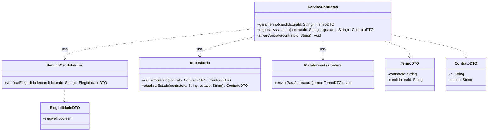
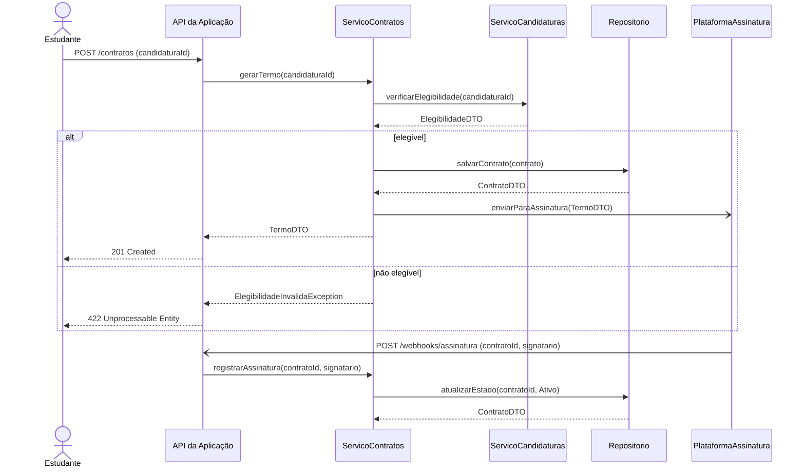
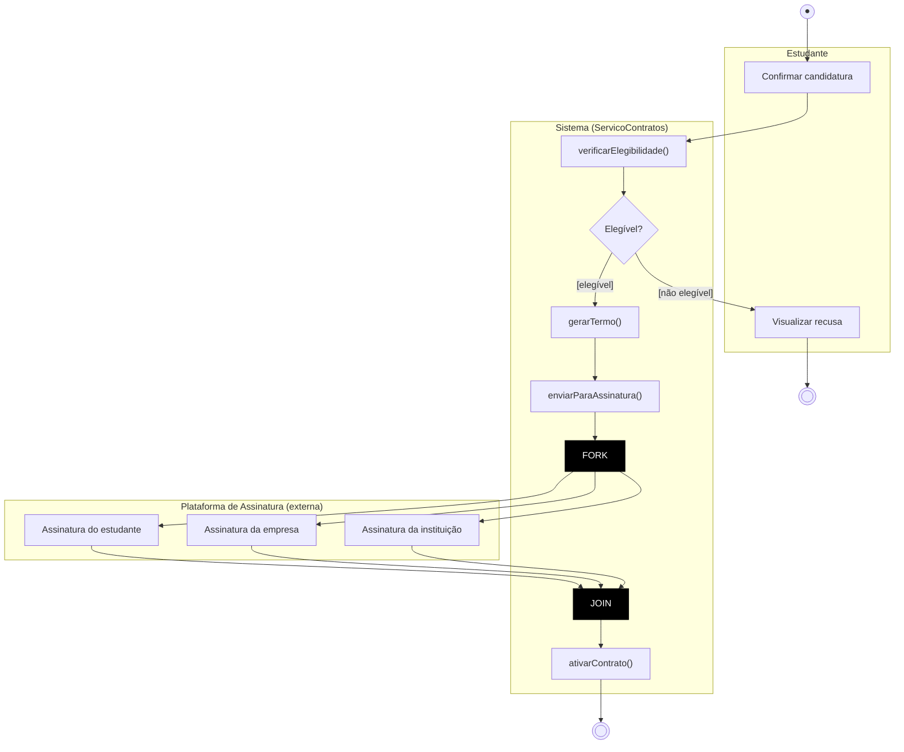
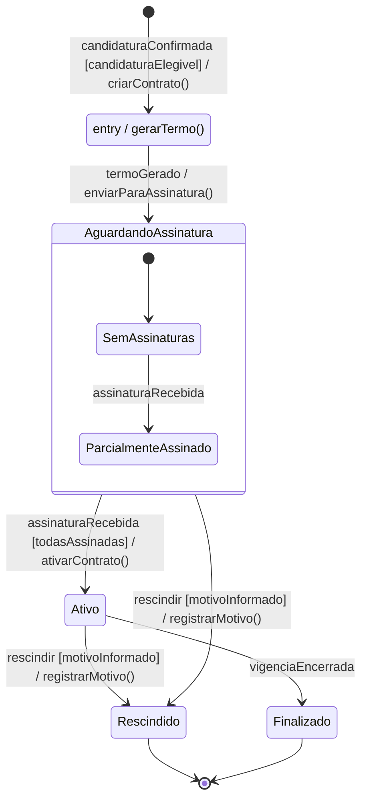

# APS 3 — Serviço de Contratos

**Aluno:** João Pedro Costa Silva (Serviço de Contratos) | **Projeto:** Gestão de Aprendizagem e Estágios da UniSenai (Grupo 6)

## Funcionalidade
Depois que a candidatura do estudante é confirmada e considerada elegível, o **Serviço de Contratos** gera o Termo de Compromisso e envia para a plataforma de assinatura externa. Quando todas as assinaturas chegam, o contrato fica **Ativo**.

## 1. Diagrama de Classes

## 2. Diagrama de Sequência

## 3. Diagrama de Atividades

## 4. Diagrama de Estados

## 5. C4 Nível 3 (Componentes)
Arquivo PlantUML: [c4-l3-servico-contratos.puml](architecture/c4-l3-servico-contratos.puml)

## 6. ADR 0001 — Assinatura assíncrona via webhook
**Status:** Proposto

**Decisão:** o termo é enviado de forma assíncrona (`enviarParaAssinatura`) e a API responde na hora. As assinaturas voltam por webhook (`POST /webhooks/assinatura`) e o contrato só vai para `Ativo` quando todas chegarem.

Texto completo: [adr-0001-assinatura-assincrona.md](adr/adr-0001-assinatura-assincrona.md)
