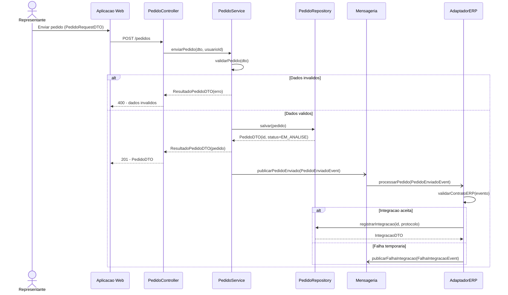
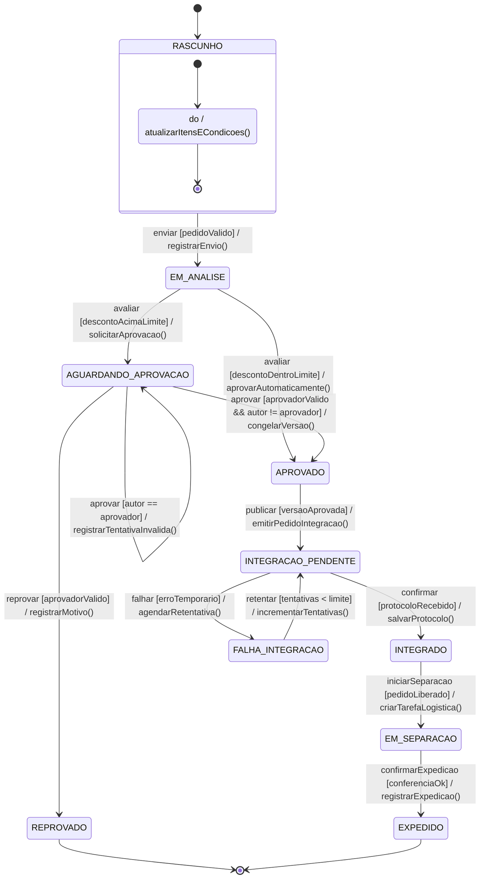

# APS 3 — Dossiê de Arquitetura Viva

**Projeto:** TONK — Plataforma de Gestão Comercial  
**Aluno:** Miguel Maester Ferreira  
**Unidade curricular:** Modelagem de Software — Engenharia de Software  
**Funcionalidade crítica:** envio, análise e aprovação de pedido comercial, com encaminhamento assíncrono ao ERP e à logística.

> Os diagramas representam uma proposta de arquitetura. A integração com o ERP TOTVS Protheus e os serviços de logística depende de contratos, credenciais e validação técnica da TONK e de seus fornecedores. Não se afirma que essas integrações já estejam implantadas.

## 1. Contexto e objetivo

O fluxo de aprovação de pedidos é crítico porque envolve preço, desconto, condições comerciais e continuidade operacional. A modelagem explicita participantes, regras de aprovação, ciclo de vida do pedido e pontos de integração.

A documentação foi escrita como código: os arquivos `.mmd` e `.puml` ficam versionados junto ao projeto. Alterações podem ser revisadas por diff e relacionadas a commits.

## 2. Regras de negócio

- O representante cria e envia um pedido.
- O sistema valida os dados e registra o pedido como `EM_ANALISE`.
- Pedidos que excedem o limite de desconto aguardam aprovador autorizado.
- O autor do pedido não pode aprovar o próprio pedido.
- Após aprovação, uma versão do pedido é encaminhada de forma assíncrona para integração.
- O pedido só é marcado como integrado após confirmação do adaptador ERP.
- Falhas ficam registradas para retentativa, sem apagar o histórico.

## 3. Artefatos

### Artefato 1 — Diagrama de Sequência

Arquivo: [`docs/diagrams/sequencia.mmd`](docs/diagrams/sequencia.mmd)



**Interfaces/operações públicas usadas:** `PedidoController.enviar(dto)`, `PedidoService.enviarPedido(dto, usuarioId)`, `PedidoRepository.salvar(pedido)`, `PedidoRepository.registrarIntegracao(id, protocolo)`, `Mensageria.publicarPedidoEnviado(evento)` e `AdaptadorERP.processarPedido(evento)`. Os DTOs/eventos estão identificados no diagrama.

### Artefato 2 — Diagrama de Atividades com Raias

Arquivo: [`docs/diagrams/atividades.mmd`](docs/diagrams/atividades.mmd)

```mermaid
flowchart TB
    subgraph R["Representante"]
      A([Início]) --> B[Preencher pedido]
      B --> C[Enviar pedido]
    end
    subgraph S["Sistema comercial"]
      C --> D[Validar cliente, itens e preços]
      D --> E{[pedido válido]}
      E -->|[true]| F[Persistir pedido EM_ANALISE]
      E -->|[false]| X[Exibir erros de validação]
      F --> G{[desconto acima do limite]}
      G -->|[true]| H[Solicitar aprovação]
      G -->|[false]| I[Aplicar aprovação automática]
      H --> J{[aprovador autorizado e não é autor]}
      J -->|[true]| K[Registrar decisão de aprovação]
      J -->|[false]| L[Rejeitar decisão e manter pendente]
      K --> M[Gravar versão aprovada]
      I --> M
      M --> N{{Fork: processamento paralelo}}
      N --> O[Gerar documento do pedido]
      N --> P[Publicar evento para ERP]
      N --> Q[Preparar fila logística]
      O --> Z{{Join: sincronização}}
      P --> Z
      Q --> Z
      Z --> T[Atualizar visão do pedido]
      T --> U([Fim])
      L --> V([Fim: aguardando aprovador])
      X --> W([Fim: corrigir dados])
    end
    subgraph E["ERP / serviços externos"]
      P -.-> Y[Adaptador valida e envia ao ERP]
      Y -.-> Y2{[resposta confirmada]}
      Y2 -->|[true]| Y3[Registrar protocolo de integração]
      Y2 -->|[false]| Y4[Registrar falha e agendar retentativa]
    end
```

**Observação:** o fork/join representa tarefas internas independentes disparadas após a aprovação. O adaptador ERP trabalha de forma assíncrona; a conclusão da integração externa não bloqueia a resposta de envio do pedido ao representante.

### Artefato 3 — Máquina de Estados

Arquivo: [`docs/diagrams/estados.mmd`](docs/diagrams/estados.mmd)



**Estados terminais:** `REPROVADO` e `EXPEDIDO`. O estado `INTEGRADO` indica confirmação do ERP; não significa que o pedido já foi expedido.

### Artefato 4 — Visão Arquitetural Macro (C4 Nível 2)

Arquivo: [`docs/architecture/workspace.dsl`](docs/architecture/workspace.dsl)

O arquivo contém uma visão de contêineres C4 em PlantUML, com tecnologias e protocolos nos conectores.

### Artefato 5 — ADR 0001

Arquivo: [`docs/architecture/adr-0001.md`](docs/architecture/adr-0001.md)

## 4. Como visualizar os diagramas

- Mermaid: cole o conteúdo dos arquivos `.mmd` em um renderizador Mermaid compatível ou use a extensão Mermaid no editor.
- C4: abra `workspace.dsl` com extensão PlantUML e suporte à biblioteca C4-PlantUML.
- Os diagramas estão em texto-fonte; o README apresenta a explicação e os caminhos de cada artefato.

## 5. Consistência entre os modelos

O envio inicia em `RASCUNHO` e, após validação, passa para `EM_ANALISE`. A regra de desconto determina se o pedido segue para aprovação manual ou automática. A aprovação congela uma versão antes da publicação do evento. O processamento externo é assíncrono e somente uma confirmação válida move o pedido para `INTEGRADO`. Falhas temporárias mantêm o pedido recuperável por retentativa.

## 6. Histórico Git

O repositório foi organizado em commits por etapa para permitir acompanhar a evolução dos artefatos. Antes de entregar, revise os nomes, acrescente decisões que você tomou durante a implementação e faça commits próprios com as alterações finais.
