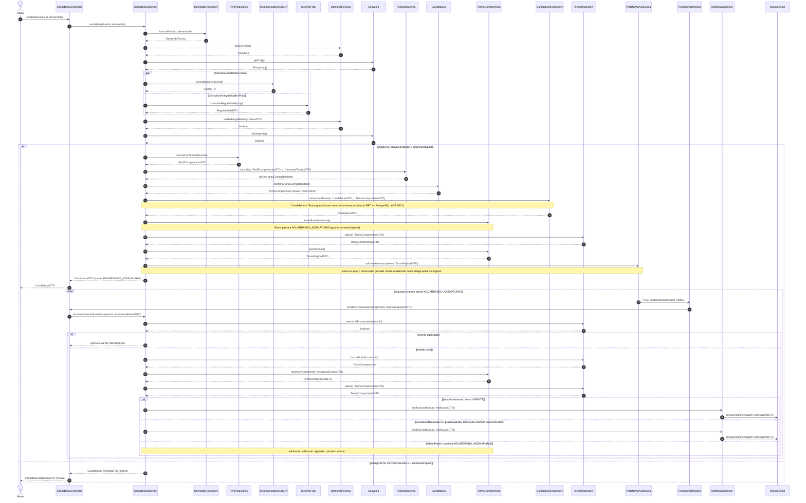
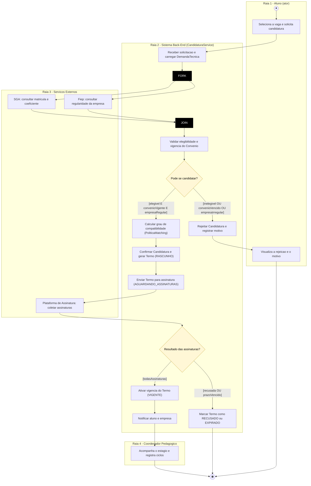
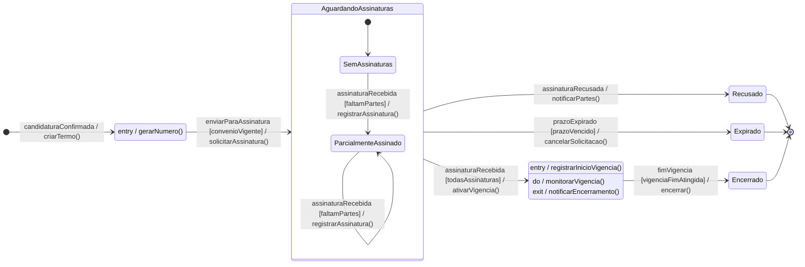

# APS 3 — Dossiê de Arquitetura Viva

**Unidade Curricular:** Modelagem de Software — Engenharia de Software (4º período, UniSenai)

**Projeto da equipe:** Pirataria Senai

**Autor:** João Pedro S. C. Lopes

## 1. Funcionalidade crítica modelada

**Candidatura → Termo de Compromisso → Assinatura Eletrônica** (RF04 e RF05 do backlog da Sprint 2).

O aluno solicita candidatura a uma demanda técnica. O sistema consulta o SGA (situação acadêmica) e o Sistema Fiep (regularidade da empresa) em paralelo, valida a elegibilidade e a vigência do convênio e calcula a compatibilidade. Estando tudo regular, confirma a candidatura, gera o `TermoCompromisso`, grava candidatura e termo em uma única transação e, só então, envia o termo para a Plataforma de Assinatura Eletrônica. A plataforma responde de forma assíncrona (webhook), uma vez por parte signatária. Quando todas assinam, o termo se torna vigente. Recusa ou prazo vencido levam o termo a `RECUSADO` ou `EXPIRADO`.

**Por que é crítica:** o termo tem validade jurídica, depende de três integrações externas e não pode ficar em estado inválido (por exemplo, vigente sem todas as assinaturas ou com convênio vencido).

**Entidade da máquina de estados:** `TermoCompromisso`.

## 2. Estrutura do repositório

```
aps3-nome-sobrenome/
├── .github/
│   └── PULL_REQUEST_TEMPLATE.md
├── docs/
│   ├── architecture/
│   │   ├── classes.puml               # Diagrama de Classes e Interfaces (PlantUML)
│   │   ├── sequencia.mmd              # Diagrama de Sequência (Mermaid)
│   │   ├── atividades.mmd             # Diagrama de Atividades com raias (Mermaid)
│   │   ├── estados.mmd                # Máquina de Estados do TermoCompromisso (Mermaid)
│   │   ├── c4-l2-containers.puml      # C4 Nível 2 (PlantUML + biblioteca C4)
│   │   ├── c4-l3-api-estagios.puml    # C4 Nível 3 da API de Estágios (PlantUML + biblioteca C4)
│   │   └── img/                       # imagens renderizadas dos .puml (para exibição neste README)
│   └── adr/
│       └── adr-0001.md                # ADR 0001
└── README.md
```

Os blocos Mermaid abaixo são cópias dos arquivos `.mmd`. Os diagramas PlantUML são exibidos como imagens renderizadas dos arquivos `.puml`. **A fonte de verdade são os arquivos em `docs/`.**

## 3. Artefato 1 — Diagrama de Classes e Interfaces

Arquivo: [`docs/architecture/classes.puml`](docs/architecture/classes.puml)


Decisões de abstração:

- `CandidaturaService` depende apenas de interfaces: repositórios (`DemandaRepository`, `PerfilRepository`, `CandidaturaRepository`, `TermoRepository`) e portas externas (`SistemaAcademicoSGA`, `SistemaFiep`, `PlataformaAssinatura`, `ServicoEmail`). O domínio não conhece o Supabase nem as APIs externas.
- A regra de transição de estados fica em `TermoCompromisso` (`enviarParaAssinatura`, `registrarAssinatura`). O serviço só orquestra.
- A chamada à plataforma de assinatura parte do serviço, e não da entidade, para o domínio não depender de integração externa.
- `CandidaturaRepository.salvarComTermo` grava `Candidatura` e `TermoCompromisso` em uma única transação (função RPC no PostgreSQL, ver ADR 0001).
- Os enums `StatusTermo` e `StatusCandidatura` usam exatamente os nomes dos estados do diagrama de estados.

## 4. Artefato 2 — Diagrama de Sequência

Arquivo: [`docs/architecture/sequencia.mmd`](docs/architecture/sequencia.mmd)

Convenções: `->>` é chamada síncrona bloqueante, `-)` é mensagem assíncrona, `-->>` é retorno com DTO. Fragmentos usados: `par` (consultas paralelas), `alt/else` (tratamento de exceção, de evento duplicado e dos desfechos da assinatura) e `loop` (eventos de assinatura).



### Regra de consistência: mensagem → operação pública

| Linha de vida | Mensagem | Operação pública declarada | Situação |
|---|---|---|---|
| CandidaturaController | `candidatar(alunoId, demandaId)` | `+ candidatar(alunoId, demandaId): CandidaturaDTO` | Nova (camada de entrada) |
| CandidaturaController | `receberEventoAssinatura(evento)` | `+ receberEventoAssinatura(evento: AssinaturaEventoDTO): void` | Nova (endpoint chamado pelo ReceptorWebhooks) |
| CandidaturaService | `candidatar(alunoId, demandaId)` | `+ candidatar(alunoId, demandaId): CandidaturaDTO` | Nova (camada de serviço) |
| CandidaturaService | `processarEventoAssinatura(evento)` | `+ processarEventoAssinatura(evento: AssinaturaEventoDTO): void` | Nova |
| DemandaRepository | `buscarPorId(id)` | `+ buscarPorId(id: UUID): DemandaTecnica` | Nova (interface) |
| PerfilRepository | `buscarPorAlunoId(alunoId)` | `+ buscarPorAlunoId(alunoId: UUID): PerfilCompetenciasDTO` | Nova (interface) |
| SistemaAcademicoSGA | `consultarAluno(alunoId)` | `GET /alunos/{id}`, contrato da API externa | Externa |
| SistemaFiep | `consultarRegularidade(cnpj)` | `GET /empresas/{cnpj}/regularidade`, contrato da API externa | Externa |
| DemandaTecnica | `getConvenio()` | `+ getConvenio(): Convenio` | Nova |
| DemandaTecnica | `validarElegibilidade(a)` | `+ validarElegibilidade(a: AlunoDTO): boolean` | Existente na Sprint 2 (o parâmetro vira `AlunoDTO`) |
| Convenio | `getCnpj()` | `+ getCnpj(): String` | Nova |
| Convenio | `estaVigente()` | `+ estaVigente(): boolean` | Existente na Sprint 2 |
| PoliticaMatching | `calcular(p, d)` | `+ calcular(p: PerfilCompetenciasDTO, d: DemandaTecnicaDTO): double` | Existente na Sprint 2 |
| Candidatura | `confirmar(grauCompatibilidade)` | `+ confirmar(grauCompatibilidade: double): TermoCompromisso` | **Alterada:** passa a receber o grau calculado |
| CandidaturaRepository | `salvarComTermo(c, t)` | `+ salvarComTermo(c: CandidaturaDTO, t: TermoCompromissoDTO): CandidaturaDTO` | Nova (interface; transação única via RPC) |
| TermoCompromisso | `enviarParaAssinatura()` | `+ enviarParaAssinatura(): void` | Existente na Sprint 2 (agora só muda o estado; o envio é feito pelo serviço) |
| TermoCompromisso | `paraPayload()` | `+ paraPayload(): TermoPayloadDTO` | Nova |
| TermoCompromisso | `registrarAssinatura(e)` | `+ registrarAssinatura(e: AssinaturaEventoDTO): TermoCompromissoDTO` | Nova |
| TermoRepository | `salvar(t)` | `+ salvar(t: TermoCompromissoDTO): TermoCompromissoDTO` | Nova (interface) |
| TermoRepository | `buscarPorId(id)` | `+ buscarPorId(id: UUID): TermoCompromisso` | Nova (interface) |
| TermoRepository | `eventoJaProcessado(eventoId)` | `+ eventoJaProcessado(eventoId: String): boolean` | Nova (interface; idempotência do webhook) |
| PlataformaAssinatura | `solicitarAssinatura(termo)` | `POST /solicitacoes`, contrato da API externa | Externa |
| ReceptorWebhooks | `POST /webhooks/assinatura` | Edge Function que valida o HMAC e repassa o evento à API | Contêiner (C4 L2) |
| NotificacaoService | `notificar(notificacao)` | `+ notificar(notificacao: NotificacaoDTO): void` | Nova |
| ServicoEmail | `enviarEmail(mensagem)` | `POST /emails`, contrato da API externa | Externa |

Os DTOs cruzam as fronteiras entre o domínio e as camadas de serviço e persistência, e entre o sistema e os serviços externos.

## 5. Artefato 3 — Diagrama de Atividades com Raias

Arquivo: [`docs/architecture/atividades.mmd`](docs/architecture/atividades.mmd)

São quatro raias: Aluno, Sistema Back-End, Serviços Externos e Coordenador. As decisões têm guardas mutuamente exclusivas. O **Fork/Join** paraleliza as consultas ao SGA e ao Fiep. O Mermaid não tem raias nativas, então as raias são emuladas com `subgraph`, e as barras de Fork e Join são nós pretos.



## 6. Artefato 4 — Diagrama de Transição de Estados (`TermoCompromisso`)

Arquivo: [`docs/architecture/estados.mmd`](docs/architecture/estados.mmd)

Transições no formato `Gatilho [Guarda] / Ação()`. O estado composto `AguardandoAssinaturas` tem subestados, e `Vigente` tem as ações internas `entry /`, `do /` e `exit /`. Os estados terminais são `Recusado`, `Expirado` e `Encerrado`. Entre `Rascunho` e `Vigente` só se chega passando por `AguardandoAssinaturas`, o que protege o termo contra estados inválidos.



## 7. Artefato 5 — Visão de Contêineres e Componentes (C4)

### C4 Nível 2 — Contêineres

Arquivo: [`docs/architecture/c4-l2-containers.puml`](docs/architecture/c4-l2-containers.puml)


Os conectores explicitam tecnologia e protocolo. As chamadas ao SGA e ao Fiep são síncronas. A assinatura e o envio de e-mail são assíncronos, e o retorno da assinatura chega por webhook, via `ReceptorWebhooks`.

### C4 Nível 3 — Componentes da API de Estágios

Arquivo: [`docs/architecture/c4-l3-api-estagios.puml`](docs/architecture/c4-l3-api-estagios.puml)


As classes `DemandaTecnica`, `Convenio`, `Candidatura` e `TermoCompromisso` pertencem ao componente "Modelo de Domínio". Os demais componentes têm o mesmo nome das classes e interfaces do diagrama de classes e das linhas de vida da sequência.

## 8. Artefato 6 — ADR 0001

Veja [`docs/adr/adr-0001.md`](docs/adr/adr-0001.md): **Adoção do Supabase (PostgreSQL gerenciado com RLS) como camada de dados**, incluindo a decisão de usar uma função RPC para a transação entre candidatura e termo.

## 9. Consistência entre os modelos

| Conceito | Classes | Sequência | Atividades | Estados | C4 |
|---|---|---|---|---|---|
| Consulta paralela ao SGA e ao Fiep | `SistemaAcademicoSGA`, `SistemaFiep` | `par ... and ... end` | Fork/Join | — | L2/L3: relações síncronas do `CandidaturaService` para SGA e Fiep |
| Elegibilidade e convênio vigente | `validarElegibilidade`, `estaVigente` | `alt [elegivel E convenioVigente E empresaRegular]` | Decisão `Pode se candidatar?` | Guarda `[convenioVigente]` em `enviarParaAssinatura` | L3: `Modelo de Dominio` |
| Gravação atômica de candidatura e termo | `salvarComTermo` | `salvarComTermo` + nota de transação única | `Confirmar Candidatura e gerar Termo` | `Rascunho` | L3: `CandidaturaRepository` (RPC); ADR 0001 |
| Envio do termo | `enviarParaAssinatura`, `paraPayload`, `solicitarAssinatura` | `enviarParaAssinatura()`, `salvar`, depois `solicitarAssinatura` | `Enviar Termo para assinatura` | `Rascunho → AguardandoAssinaturas` | L3: relação assíncrona para `PlataformaAssinatura` |
| Assinatura assíncrona | `receberEventoAssinatura`, `processarEventoAssinatura`, `registrarAssinatura` | `-)` + `loop` + `registrarAssinatura()` | `Plataforma de Assinatura: coletar assinaturas` | `assinaturaRecebida [faltamPartes]` | L2: `ReceptorWebhooks`; L3: `CandidaturaController` |
| Idempotência do webhook | `eventoJaProcessado` | `alt [evento duplicado]` | — | — | L3: `TermoRepository`; ADR 0001 |
| Todas as partes assinaram | `StatusTermo.VIGENTE` | `alt [todasAssinaturas]` | `[todasAssinaturas]` | `→ Vigente / ativarVigencia()` | — |
| Recusa ou prazo vencido | `registrarAssinatura` (eventos RECUSADA e EXPIRADA) | `alt [assinaturaRecusada OU prazoExpirado]` | `[recusada OU prazoVencido]` | `Recusado` e `Expirado` | — |
| Notificação | `NotificacaoService`, `ServicoEmail` | `notificar` + `enviarEmail` | `Notificar aluno e empresa` | `notificarPartes()` | L2: `ServicoEmail`; L3: `NotificacaoService` |

## 10. Observações e pendências

- **Fiep na candidatura:** a consulta de regularidade no momento da candidatura é uma decisão desta APS. Na Sprint 2 ela aparece como `include` de *Homologar convênio*.
- **Estados da `Candidatura`:** `status` é `String` na Sprint 2. O diagrama de classes passa a usar o enum `StatusCandidatura`, e os estados do termo (`RASCUNHO`, `AGUARDANDO_ASSINATURAS`, `VIGENTE`, ...) devem usar exatamente os nomes de `StatusTermo` no código.
- **Expiração e encerramento:** na sequência, `prazoExpirado` chega como evento da plataforma de assinatura. A transição `Vigente → Encerrado` (`fimVigencia`) é disparada por rotina agendada, que não está modelada nesta entrega.
- **Falha no envio da solicitação:** se `solicitarAssinatura` falhar depois de o termo ser gravado como `AGUARDANDO_ASSINATURAS`, o termo fica sem solicitação. Risco aceito e registrado no ADR 0001. Uma reconciliação periódica seria a evolução natural.
- **ADR 0002 (a avaliar):** estratégia completa de idempotência e reenvio de webhooks.
